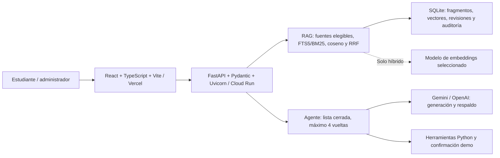

# Titulación y normativa académica · Grupo 1

> Seminario «Ingeniería de Software con IA Generativa» · UNIANDES · 2026
> Integrantes: Aguilar Rogel Olmes Patricio; Cevallos Mazon Widman Yadiro; Torres Lopez Christian Felipe.

## Qué problema resuelve y para quién

Los estudiantes necesitan interpretar requisitos y opciones de titulación dispersos en normativa nacional e institucional, sin confundir orientación con una decisión oficial. El asistente recupera fragmentos de fuentes aprobadas y vigentes, responde con documento y artículo/sección verificables y pide contexto cuando es necesario. También ofrece requisitos, checklist orientativo, calendario simulado y borradores demo con confirmación humana. Si falta evidencia, se abstiene o deriva a Secretaría Académica; no certifica cumplimiento ni modifica expedientes.

## Demo

- **Aplicación pública:** https://seminario-complexivo-grupo1.vercel.app/
- **Administración:** https://seminario-complexivo-grupo1.vercel.app/admin
- **Métricas:** https://seminario-complexivo-grupo1.vercel.app/metricas
- **API:** https://titulacion-rag-386902880383.us-central1.run.app
- **Proceso y revisión:** https://titulacion-rag-386902880383.us-central1.run.app/health
- **Corpus disponible:** https://titulacion-rag-386902880383.us-central1.run.app/ready
- **Contrato HTTP:** https://titulacion-rag-386902880383.us-central1.run.app/docs

Frontend en **Vercel**, backend en **Cloud Run**, región `us-central1`. Última ejecución de despliegue verificada: [Actions 42389025186](https://github.com/felipet73/SeminarioComplexivoGrupo1/actions/runs/42389025186), commit **`c1a5f3f`**, aprobada el 7 de noviembre de 2026. Incluye smoke con registro de métricas y 35 casos públicos, con generación real directa y por proxy. Esta evidencia corresponde a esa revisión; un cambio posterior exige repetir las comprobaciones.

`/health` acredita el proceso y su revisión declarada; `/ready` comprueba corpus elegible e índice actual, **no disponibilidad del proveedor**. El servicio puede tener arranque en frío al escalar a cero; no se ha acreditado aquí un tiempo máximo ni disponibilidad durante 24 horas.

## Arquitectura



- **Frontend:** chat, campos de contexto/aclaración, citas, confirmación, administración y métricas. `frontend/vercel.json` configura la SPA y el proxy `/api`; en desarrollo Vite usa un proxy específico para administración.
- **Backend:** contratos HTTP, autenticación, flujo compartido de chat/simulación y validación final de JSON, IDs citados y revisión de fuentes.
- **RAG:** ingesta con SHA-256, páginas y secciones; recuperación léxica o híbrida. SQLite FTS5/BM25 más vectores de 768 dimensiones, coseno exhaustivo y fusión RRF; no se usa Chroma ni ANN. Límite local: 5000 fragmentos.
- **Modelos:** generación con `gemini-3.5-flash-lite` y `gpt-4.1-mini` por defecto. Embeddings independientes: `gemini-embedding-001` o `text-embedding-3-small`; se elige uno y no se mezclan sus vectores.
- **Agente:** `buscar_fragmentos`, `consultar_requisitos`, `generar_checklist`, `calcular_plazo` y `registrar_solicitud_tutor`. Solo ejecuta funciones permitidas con argumentos validados; el borrador requiere decisión humana.

Detalle: [arquitectura](docs/03-arquitectura.md), [RAG](docs/06-rag.md), [secuencias y 31 operaciones de API](docs/analisis-tecnico-preliminar.pdf).

## Cómo ejecutarlo en local

Requisitos: **Git, Python 3.12 y Node 22 actualizado —compatible con Vite— o Node 24**; `npm` incluido. Ejecutar desde la raíz salvo donde se indique. No se necesita Docker para desarrollo local.

### 1. Clonar y preparar Python

```bash
git clone https://github.com/felipet73/SeminarioComplexivoGrupo1.git
cd SeminarioComplexivoGrupo1
python -m venv backend/.venv
```

Activar el entorno en **Linux/macOS**:

```bash
source backend/.venv/bin/activate
```

O en **Windows PowerShell**:

```powershell
.\backend\.venv\Scripts\Activate.ps1
```

Después, con ese entorno activado:

```bash
python -m pip install -r backend/requirements-dev.txt
```

### 2. Configurar e ingerir las fuentes

En una instalación nueva, copiar [.env.example](.env.example) a `.env` en la raíz. **No sobrescribir un archivo existente ni subirlo a Git**. Completar de forma privada la clave del proveedor que se vaya a usar y `ADMIN_PASSWORD` para administración. Las variables se explican en la sección siguiente.

Para preparar el corpus sin API de modelos:

```bash
python scripts/ingest.py --strategy lexical
```

La ingesta valida hashes y reutiliza documentos idénticos; no cambia el estado de aprobación humana. **Para obtener respuestas generativas**, incluso con recuperación léxica, hace falta al menos una clave válida. Los tests y el smoke de rechazo local no la necesitan.

Para preparar **en lugar de la anterior** una estrategia híbrida con credencial y cuota:

```bash
# Embeddings Gemini:
python scripts/ingest.py --strategy hybrid --embedding-model gemini-embedding-001
# O embeddings OpenAI:
python scripts/ingest.py --strategy hybrid --embedding-model text-embedding-3-small
```

Elegir un modelo de embeddings; cambiarlo exige reindexar. El selector del modelo de chat no cambia el índice.

### 3. Ejecutar backend y frontend en dos terminales

**Terminal 1**, entorno Python activado:

```bash
cd backend
python -m uvicorn app.main:app --reload --host 127.0.0.1 --port 8000
```

**Terminal 2**, desde la raíz:

```bash
cd frontend
npm ci
npm run dev
```

Abrir `http://localhost:5173`; panel `/admin`, dashboard `/metricas`, contrato `http://127.0.0.1:8000/docs`. Comprobar primero `/health` y `/ready` en la API. El usuario administrativo inicial es `admin`; la contraseña debe proceder de la configuración privada. Desarrollo usa API local; `frontend/.env.production` solo aporta una URL pública al build de producción.

El objetivo docente de instalación en diez minutos debe cronometrarlo otro integrante y conservar su evidencia; no se presenta como tiempo medido de una instalación nueva.

## Variables de entorno

Referencia completa: [.env.example](.env.example) y [frontend/.env.example](frontend/.env.example). **No se publican valores de credenciales**. Settings lee el `.env` de la raíz; los cambios requieren reiniciar el backend o desplegar una nueva revisión.

| Variable / grupo | Función y ubicación |
|---|---|
| `GEMINI_API_KEY`, `OPENAI_API_KEY` | Secretos de los proveedores; solo backend. La clave del proveedor sirve a su cliente generativo y al de embeddings cuando se selecciona. |
| `ADMIN_PASSWORD` | Secreto de administración; no tiene una contraseña fija válida por defecto. |
| `ADMIN_USERNAME`, `ADMIN_SESSION_MINUTES`, `ADMIN_COOKIE_SECURE` | Usuario, duración de sesión y cookie Secure; activar Secure en HTTPS de producción. |
| `APP_NAME`, `APP_ENV`, `APP_REVISION` | Nombre, entorno y revisión declarada del build. |
| `CORS_ORIGINS` | Orígenes autorizados explícitos; no configurar comodín para administración. |
| `AI_MODEL`, `FALLBACK_MODEL` | Nombres configurables de los modelos generativos. |
| `LLM_TIMEOUT_SECONDS`, `LLM_RETRIES`, `LLM_MAX_INPUT_CHARS` | Timeout, reintentos técnicos y máximo de entrada. Defaults y alcance se detallan en integración estable. |
| `RAG_DATA_DIR` | Directorio del proceso para SQLite y originales; cambiarlo no crea almacenamiento duradero. |
| `PORT` | Puerto que usa el comando de arranque del contenedor. |
| `VITE_API_URL` | URL pública del backend incorporada al build del navegador; **no admite secretos**. |
| `VITE_ADMIN_API_TARGET` | Destino del proxy administrativo de Vite en desarrollo. |
| `GCP_PROJECT_ID`, `GCP_AR_REPOSITORY`, `GCP_WORKLOAD_IDENTITY_PROVIDER`, `GCP_SERVICE_ACCOUNT` | Variables de GitHub Actions para despliegue; son identificadores, no claves LLM. |

`AI_API_KEY`, aunque permanece en el ejemplo de entorno, **no se lee como clave en Settings**: usar `GEMINI_API_KEY` o `OPENAI_API_KEY`. `AI_PROVIDER` y `FALLBACK_PROVIDER` están declaradas, pero el orden real de los clientes lo determina `modelo_preferido` y las claves disponibles. `APP_HOST`/`APP_PORT` del ejemplo no sustituyen los flags de Uvicorn ni `PORT` del contenedor.

En producción se usan **Secret Manager y referencias de Cloud Run**; la cuenta de ejecución requiere acceso a cada secreto. Los Secrets de **GitHub Actions** para evaluación se configuran aparte: no heredan los de Cloud Run. La autenticación de despliegue usa **WIF**, sin clave JSON permanente; `GCP_SA_KEY` es solo la alternativa implementada si no se usa WIF.

La configuración de negocio se referencia en [config/parametros.yaml](config/parametros.yaml): agente de 4 vueltas, presupuesto de 30 consultas/60 segundos/proceso, fragmentación 1400/160, top-k 4, umbrales y criterios de evaluación. El panel guarda su configuración RAG en SQLite. La imagen siembra explícitamente modo léxico; no asumir que el default híbrido del archivo sea el estado de producción.

## Despliegue

El flujo implementado está en [.github/workflows/ci.yml](.github/workflows/ci.yml):

1. Push/PR ejecuta secretos, backend, frontend, navegador y contenedor.
2. `desplegar` requiere el éxito de esos cinco jobs y solo opera en `main` por push o activación manual.
3. Conserva la imagen Docker que pasó el smoke, autentica con GitHub OIDC/WIF y publica en Artifact Registry con etiqueta SHA.
4. Actualiza Cloud Run y verifica SHA, corpus, retirada legacy, SSE y registro de métricas. Ejecuta obligatoriamente 35 casos públicos con generación real.
5. Un fallo posterior deja el job rojo; **no hay rollback automático**. Vercel publica el frontend desde Git mediante su integración.

Servicio backend: `titulacion-rag`, región `us-central1`; configuración y permisos en [docs/13-despliegue.md](docs/13-despliegue.md). El workflow usa memoria 1 GiB y entre cero y una instancia; esto no garantiza durabilidad. Última corrida aprobada: [42389025186 / c1a5f3f](https://github.com/felipet73/SeminarioComplexivoGrupo1/actions/runs/42389025186).

Para verificar el **contenedor local**, desde la raíz, en Bash:

```bash
revision=$(git rev-parse HEAD)
docker build --build-arg APP_REVISION="$revision" -f backend/Dockerfile -t titulacion-rag:local .
docker run --rm -p 8080:8080 titulacion-rag:local
```

En otra terminal, también desde raíz:

```bash
python scripts/smoke_container.py --url http://127.0.0.1:8080
```

En PowerShell se puede definir `$revision = git rev-parse HEAD` y usar `--build-arg "APP_REVISION=$revision"` en el mismo comando de build. Para exigir coincidencia de revisión, añadir `--expected-revision` con el SHA completo esperado. El contenedor local arranca sin claves con semilla léxica; generar respuestas requiere secretos de ejecución, nunca incluidos en la imagen.

## Datos en producción

**Implementación actual, no infraestructura deseada:**

| Dato | Dónde vive y qué ocurre al recrear la instancia |
|---|---|
| Corpus original y semilla léxica | Dentro de la imagen; restaura el corpus base al arrancar. No conserva nuevas cargas por ese mecanismo. |
| Fragmentos, FTS5 y vectores activos | SQLite en `data/admin/` por defecto, configurable con `RAG_DATA_DIR`; los cambios locales no tienen durabilidad garantizada en Cloud Run. |
| Cargas, metadatos, borradores confirmados y auditoría | Directorio local y SQLite; no se ha implementado almacenamiento externo duradero. Usar datos ficticios. |
| Configuración RAG y prompts | Defaults/archivos en imagen y registros/revisiones en SQLite; ediciones locales pueden perderse al recrear. |
| Historial de conversación | Memoria de la interfaz, sin memoria conversacional persistente en servidor; puede perderse al recargar. |
| Sesiones admin y presupuesto de consultas | Memoria del proceso; se reinician con él. |
| Métricas | Archivo local rotatorio `logs/metrics.jsonl`; puede perderse con la instancia. El permiso de escritura del contenedor está corregido. |
| Credenciales | Secret Manager/referencias de ejecución; los valores no se guardan en el frontend o repositorio. Persiste exposición histórica legacy documentada. |

**Qué aceptamos perder y por qué:** el historial de conversación es de sesión y el alcance académico es una demo. Esto no autoriza a tratar cargas, auditoría o borradores como registros institucionales duraderos. Para conservarlos se necesita infraestructura y adaptación verificadas; cambiar solo el directorio o limitar instancias no basta. El ensayo remoto de reinicio con respuesta citada sigue pendiente de evidencia. Ver [decisión objetivo de persistencia](docs/ADR-0003.md) y [plan de cierre](docs/17-plan-cierre-y-tamano.md).

## Pruebas y evaluación

Desde la raíz y con el entorno backend activado:

```bash
python -m pytest -q -c backend/pyproject.toml backend/tests --cov=app --cov-fail-under=85
python -m ruff check backend scripts eval
python scripts/check_secrets.py
python scripts/ingest.py --data-dir data/eval-state --strategy lexical
python eval/evaluar.py
python eval/evaluar_flujo.py
```

En `frontend/`:

```bash
npm test
npm run build
npx playwright install chromium
npm run test:admin
```

Pytest y el navegador usan estado temporal y proveedores bloqueados/dobles declarados; no consumen APIs reales. Playwright necesita Chromium y la venv en `backend/.venv`. La suite `test:admin` arranca su API y frontend aislados; no apuntarla a producción.

**Contra las URLs públicas**, desde raíz, con generación real y consumo del proveedor:

```bash
python scripts/pruebas_funcionales.py --incluir-modelo --output eval/results-funcionales-modelo.json
# Entrada compatible para la misma suite:
python backend/tests/smoke.py https://titulacion-rag-386902880383.us-central1.run.app --incluir-modelo --output eval/results-smoke-manual.json
```

Sin `--incluir-modelo` se seleccionan 32 contratos, no 35. Para exigir el commit correcto, añadir `--expected-revision` con el SHA completo de la revisión publicada por Actions. Guardar salida y JSON fechados en `docs/evidencias/semana-4/`; un fallo devuelve exit 1 y no se cuenta como aprobado. Si la recuperación está en híbrido puede consumir embeddings además de generación.

| Verificación real | Resultado y alcance |
|---|---|
| Backend actual | **105 pruebas aprobadas, 88,73 %** de cobertura; umbral 85 %. Incluye prueba del empaquetador. [Evidencia local](docs/evidencias/semana-4/metricas-permisos-2026-11-07.json); job remoto aprobado para `c1a5f3f`. |
| Frontend y navegador | **18 pruebas**, build y **10 escenarios** Playwright con API aislada y modelo doble; jobs remotos aprobados. |
| Producción | **35/35**, incluidos tres casos generativos, rutas retiradas y contratos públicos; [Actions 42389025186](https://github.com/felipet73/SeminarioComplexivoGrupo1/actions/runs/42389025186). El smoke adicional exige incremento de métricas. |
| Smoke manual aportado por el equipo | **35/35, cero omitidos; p95 2,453 s** en esa corrida. No es prueba de carga ni disponibilidad 24 h y se ejecutó sin exigir SHA. [Registro del resultado observado](docs/evidencias/semana-4/smoke-manual-observado-2026-11-07.json). |
| Recuperación léxica final local | **14/16 positivos, 4/4 negativas, cero errores**, igual al baseline histórico; [reporte](docs/evidencias/semana-4/recuperacion-lexica-final-2026-11-07.json). Flujo con modelo doble: **20/20**. |
| Evaluación híbrida/chat de semana 3 | Híbrido **16/16** artículos y chat con citas **16/16**, negativas **4/4**, según [evaluación y archivos históricos](docs/07-evaluacion.md). No se presentan como una nueva corrida final. |
| Agente real, último resultado estricto | Elección/ejecución de checklist **6/6**, listas finales citadas **5/6**. Falta normativa institucional aprobada para el caso de complexivo; no se rebaja el criterio para convertirlo en aprobado. |

Para repetir la evaluación completa con claves y cuota, desde raíz:

```bash
python -u eval/comparar.py --embedding-model text-embedding-3-small
python eval/evaluar.py --data-dir data/eval-hybrid --chat --prompt system_v3 --output eval/results-chat-hybrid.json
python eval/evaluar_agente_real.py --modelo gemini
```

También existe [.github/workflows/evaluacion-final.yml](.github/workflows/evaluacion-final.yml), **Evaluación final sin despliegue**, activado manualmente. Requiere Secrets de Actions y no actualiza Cloud Run. Preparar ese workflow no equivale a ejecutarlo. En cambio, activar manualmente el workflow principal en `main` puede desplegar además de evaluar.

Criterios completos: [docs/08-pruebas.md](docs/08-pruebas.md), [docs/07-evaluacion.md](docs/07-evaluacion.md), [plan de calidad](docs/11-plan-de-calidad.md). Las citas estructurales no certifican implicación semántica de cada afirmación; hace falta revisión humana.

## Integración estable con el modelo

| Control | Estado real | Implementación |
|---|---|---|
| Tiempo límite por llamada | **15 s por defecto**; no es duración máxima de toda la consulta | `backend/app/config.py`, `services/llm.py` |
| Reintentos con espera creciente | Implementados, **desactivados por defecto (`LLM_RETRIES=0`)**; si se activan, cuota, timeout y errores de proveedor usan espera exponencial y jitter | `backend/app/services/llm.py`; SDK sin reintentos internos adicionales |
| Proveedor alternativo | Sí, si está configurado y se permite fallback; preferido por consulta, después el otro | Gemini/OpenAI; simulaciones comparativas sin fallback |
| Límite de solicitudes | **Global por proceso**, 30 POST/60 s compartidos entre chat/stream/agente; 429 y Retry-After | `backend/app/rate_limit.py`, `config/parametros.yaml`; no cuota por usuario/IP ni distribuida |
| Tamaño de entrada y salida | Pregunta hasta 2000 caracteres; generación solicita hasta 1200 tokens de salida; agente hasta 4 vueltas | `schemas.py`, `services/llm.py`, `agente.py` |
| Error seguro y recuperación de interfaz | 503 con mensaje controlado si no hay proveedor disponible; se conservan datos para reintentar | `services/chat_flow.py`, `frontend/src/api.ts` y componentes |
| Arranque en frío | Corpus base sembrado y health/ready verificados; primera generación tras frío sin fallo **no garantizada** | Imagen y smoke; falta ensayo específico de frío/continuidad |
| Registro sin texto sensible | Allowlist técnica, rotación y contadores; no guarda pregunta, respuesta, clave ni excepción cruda en métricas | `services/metrics.py`; escritura y caché corregidas en `c1a5f3f` |

El agente puede pedir herramientas antes de terminar: una consulta puede sumar varias llamadas, fallos y respaldo. La respuesta se genera antes de emitir los eventos SSE `token`/`done`; no se retransmiten tokens del SDK en tiempo real. El calendario y la confirmación de borradores son deterministas; una abstención local sin evidencia o un rechazo de inyección puede evitar generación.

## Decisiones y riesgos

- [ADR y decisiones técnicas/éticas](docs/09-decisiones.md): alcance controlado, lista cerrada, confirmación humana, citas y alternativa SQLite/FTS5/vectores a Chroma.
- [Decisión objetivo sobre datos](docs/ADR-0003.md): distingue infraestructura deseada de la persistencia local realmente desplegada.
- [Registro de riesgos](docs/riesgos.md): mitigaciones, evidencia y riesgo residual; no contiene valores de secretos.
- [Auditoría de credenciales históricas](docs/15-auditoria-credenciales-historicas.md): las exclusiones de Gitleaks son falsos positivos de un advisory; el mecanismo JWT legacy contenía credenciales funcionales y sigue en commits antiguos. Código y rutas actuales retirados no equivalen a historial limpio ni acreditan revocación en otras copias.

## Limitaciones conocidas

- Orientación educativa, no resolución universitaria, certificación de cumplimiento ni acceso a expedientes. Usar datos ficticios; revisar [tratamiento de datos](docs/16-datos-y-limites.md).
- Corpus: cinco fuentes aprobadas, 961 fragmentos; el instructivo UNIANDES con OCR aporta otros 86 **sin aprobar y no elegibles**. La aprobación y vigencia son decisiones humanas.
- Checklist extractivo: `pendiente_de_verificar` y `completo=false`; no determina si un estudiante cumplió requisitos. El calendario excluye fines de semana y fecha inicial, **no feriados ni plazos institucionales**.
- Los borradores requieren confirmación, caducan y son idempotentes; solo se guardan localmente, no se envían a terceros ni asignan tutor. La capacidad demo no prueba identidad universitaria.
- Persistencia, sesiones, presupuesto y métricas son locales; no hay garantía de conservar cambios entre instancias. Queda pendiente el ensayo de reinicio y una solución duradera si se usan datos importantes.
- Evaluación final completa frente a semana 3 y resultado estricto del agente todavía pendientes de nueva evidencia; tres consultas públicas no sustituyen esos conjuntos.
- Historial Git con credenciales legacy pendiente de remediación coordinada; no se oculta con nuevas exclusiones. Tampoco se garantiza resistencia a toda inyección o disponibilidad continua del proveedor.
- Paquete medido: aproximadamente **24,82 MiB**, todavía sobre el máximo docente de **20.000.000 bytes**. El corpus comprimido por sí solo supera 20 MB. [Plan y medición](docs/17-plan-cierre-y-tamano.md); no se entrega un ZIP sobredimensionado ni se alteran hashes para ocultarlo.

## Integrantes y responsabilidades

| Integrante | Identidades registradas en Git | Responsabilidad y verificación individual |
|---|---|---|
| Aguilar Rogel Olmes Patricio | `olmesaguilar` | Por confirmar por el integrante: tareas asumidas, uso de IA, revisión y evidencia que puede explicar. |
| Cevallos Mazon Widman Yadiro | `WidmanCevallos`, `Widman Yadiro Cevallos Mazon` | Por confirmar por el integrante: tareas asumidas, uso de IA, revisión y evidencia que puede explicar. |
| Torres Lopez Christian Felipe | `Felipe Torres`, `Felipe Torres Lopez` | Por confirmar por el integrante: tareas asumidas, uso de IA, revisión y evidencia que puede explicar. |

**Declaración de IA:** se utilizó asistencia de Codex para análisis, implementación, pruebas, documentación y material de presentación. Se revisaron y corrigieron resultados mediante tests, contratos y evidencia explícita; los modelos también intervienen en el producto según lo descrito. Un commit firmado con la configuración del equipo no demuestra autoría manual ni identifica quién revisó cada salida. Cada integrante debe completar y validar su responsabilidad antes de declarar cumplido ese requisito; no se inventan aportes o porcentajes individuales.

Material de entrega: [checklist s4a–s4k](docs/14-checklist-entrega-final.md), [presentación PDF](docs/presentacion-entrega4.pdf), [informe técnico PDF](docs/analisis-tecnico-preliminar.pdf), [observaciones de sustentación](docs/evidencias/semana-4/observaciones-sustentacion.md).

Para medir el ZIP desde raíz: `python scripts/empaquetar_entrega.py --medir`. Devuelve exit 1 si supera 20 MB y no deja un entregable sobredimensionado; solo incluye archivos conocidos por Git y excluye secretos locales, dependencias y caches. Antes de entregar, revisar el informe, el estado de Git y el detector activo; el empaquetador no acredita historial limpio.
