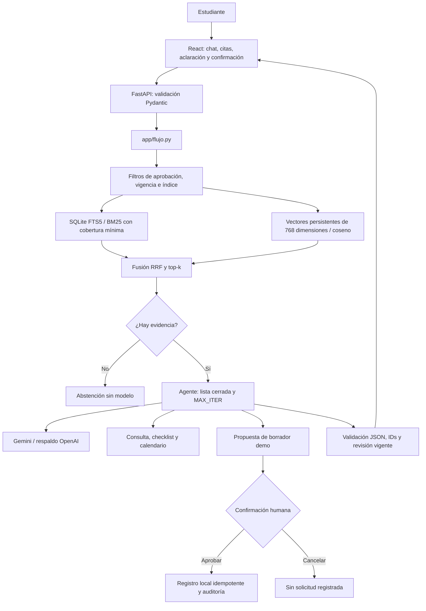

# Arquitectura implementada — Entrega 3

El frontend es React 19 con Vite y TypeScript. El backend es FastAPI. El estado privado, los originales y los índices se guardan en `data/admin/`, ignorado por Git. Las fuentes reproducibles están en `data/raw/manifest.json` y su vigencia se configura en `config/fuentes.yaml`.

La búsqueda híbrida combina rankings, no concatena vectores de proveedores distintos. El modelo de embeddings se selecciona explícitamente: Gemini o text-embedding-3-small. Cambiarlo invalida el índice hasta reindexar. La caché usa hash de modelo, tarea y texto; reduce repetición de llamadas y conserva progreso ante cuota agotada. Gemini tiene control conservador por minuto y reintentos acotados. Un fallo de consulta semántica permite usar BM25; un fallo de indexación no reemplaza el índice previo.

SQLite guarda los vectores JSON en `chunks.vector` y el texto en FTS5. La similitud se calcula exhaustivamente sobre hasta 5000 fragmentos. Esta implementación persistente sustituye la propuesta inicial de Chroma; no existe un índice ANN. Las nuevas instalaciones usan estrategia híbrida; las instalaciones anteriores se migran con ingesta o activación explícita del índice evaluado.

Rutas principales: `/health`, `/docs`, `/api/chat`, `/api/chat/stream`, `/api/metricas`, `/api/sources/{id}/{revision}`, `/api/admin/*` y `/api/herramientas/*`. El SSE transmite únicamente texto ya validado. La ruta de herramientas publica esquemas generados por Pydantic. Las decisiones humanas usan `/api/herramientas/agente/confirmar/{id}`.

El modelo no modifica expedientes ni envía solicitudes. Solo puede proponer un borrador demo que el usuario confirma con una capacidad secreta y caducidad. La decisión guarda auditoría y no admite cambios de argumentos; repetirla no duplica la solicitud. El actor de demostración identifica una capacidad, no una identidad institucional verificada.

Las métricas no guardan preguntas, contexto académico ni claves. La validación de citas comprueba procedencia y vigencia, no implica una demostración automática de cada afirmación. Detalles de decisiones, automatización y calidad en `09-decisiones.md`, `10-automatizacion.md` y `11-plan-de-calidad.md`.
