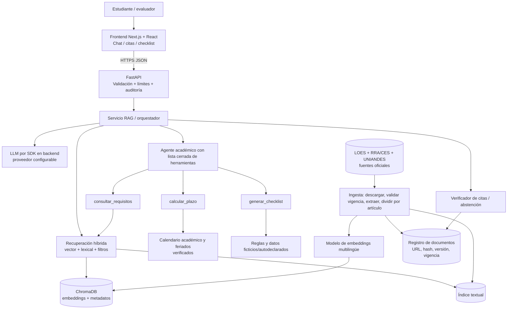
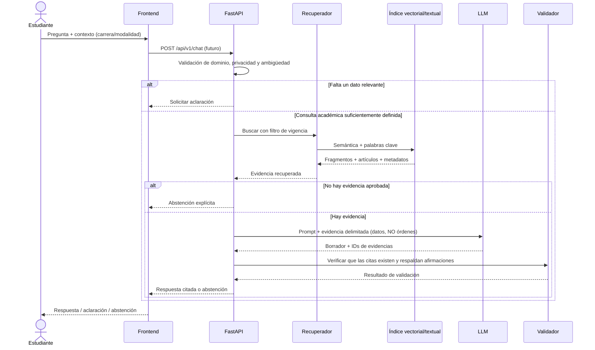

# 03. Arquitectura propuesta — Semana 1

## Vista de componentes

## Flujo completo de una consulta

## Herramientas del agente

- `consultar_requisitos(modalidad: str, carrera?: str) -> {items:[{regla, fuente, articulo}]}`: consulta de reglas aprobadas; nunca escribe registros oficiales.
- `calcular_plazo(fecha_inicio: date, dias_habiles: int, calendario_id: str) -> {fecha_fin, fundamento, calendario}`: cálculo determinista con feriados explícitos; si calendario no está aprobado, error controlado.
- `generar_checklist(perfil_estudiante: PerfilDemo) -> {items:[{estado, evidencia, requisito}]}`: sin inventar cumplimientos; estados `cumplido`, `pendiente`, `no_verificable`.

## Modelo de datos mínimo

`Document` (document_id, title, institution, source_url, publication_date, verified_at, effective_from, effective_to, verification_status, sha256, local_path); `Chunk` (chunk_id, document_id, article, section, text, page_start, page_end, embedding_id); `EvaluationCase` (case_id, question, expected_type, expected_answer, expected_document, expected_article); `AuditEvent` (request_id, latency_ms, outcome, source_ids; sin PII).

## Seguridad y decisiones

1. API key solo en variables de entorno backend. `.env` ignorado; `.env.example` sin secretos.
2. Bloqueo de herramientas fuera de allowlist y validación de entradas con Pydantic.
3. Solo documentos aprobados entran al índice de producción; prohíbe respuestas oficiales desde fuentes pendientes.
4. No se implementa integración con expediente académico real en Semana 1.
5. ChromaDB se propone para MVP; PostgreSQL + pgvector es alternativa para despliegue y escala, su migración no altera interfaces de repositorio.
6. `/health` incluido y funcional; endpoints RAG descritos son **futuros**, no implementados todavía.

## Despliegue propuesto

Local: Python virtualenv + FastAPI; frontend y vector DB se añadirán en fase siguiente. Producción: Render/Railway o plataforma aprobada, HTTPS y configuración de secretos en panel. Puntos a revisar: persistencia ChromaDB en volumen duradero, límites de uso y cuotas del proveedor LLM.
